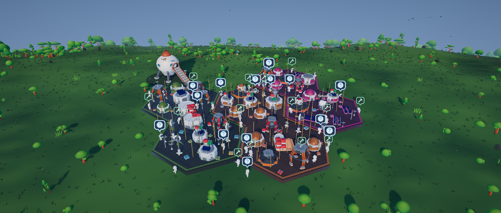
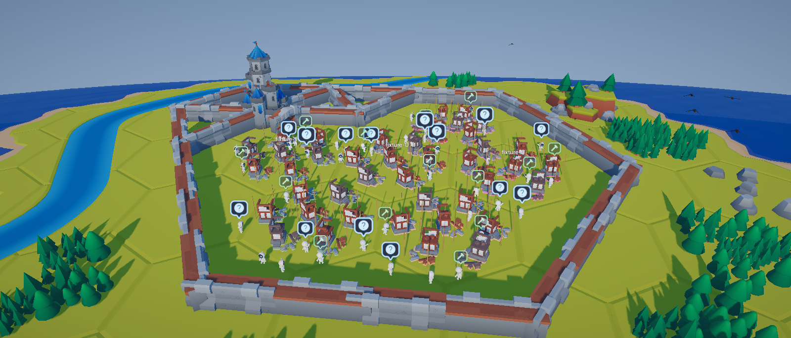
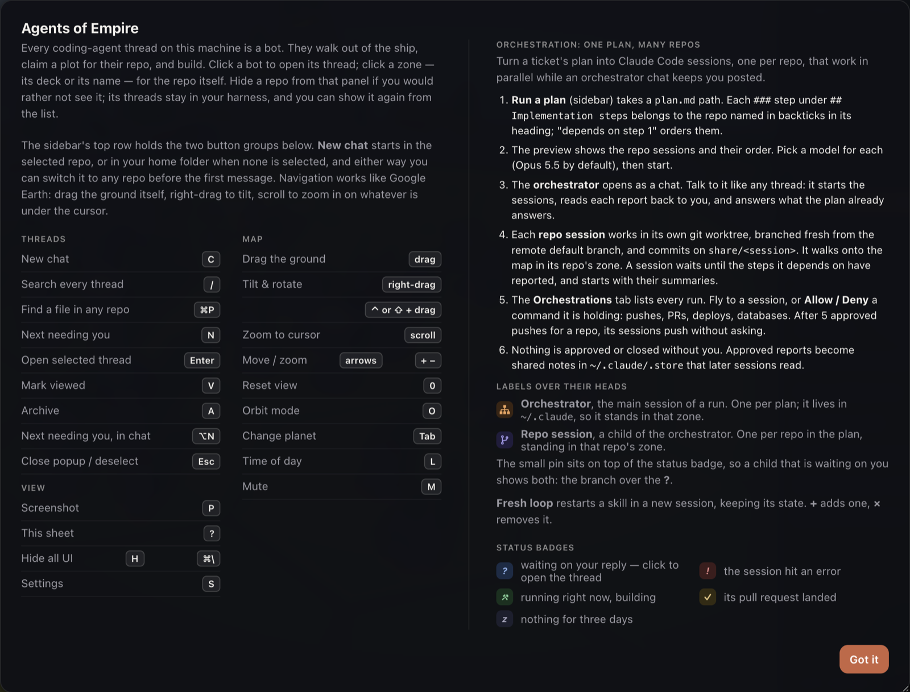
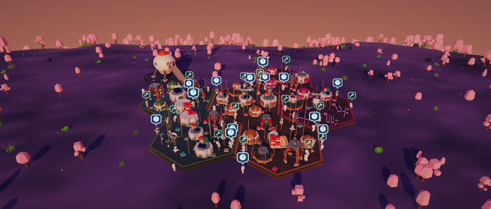

# Agents of Empire

A 3D colony for **every coding-agent thread on your computer**. Each thread is a bot that walks
out of the ship, claims a plot for its repo and builds while it works. Chat with any Claude Code
thread from the map, approve its tool calls, and run one plan across many repos at once while
an orchestrator keeps you posted.



A fork of [**Bot Crossing**](https://github.com/jarrenrocks/bot-crossing) by Jarren Rocks
([@jarrenrocks](https://github.com/jarrenrocks)), which draws the colony, the bots and the
harness adapters. This fork adds chat, thread control and multi-repo orchestration.


---

## Contents

- [What you get](#what-you-get)
  - [The colony](#the-colony)
  - [Chat and control](#chat-and-control)
  - [Orchestration: one plan, many repos](#orchestration-one-plan-many-repos)
  - [Desktop app](#desktop-app)
  - [Keyboard](#keyboard)
- [Quick start](#quick-start)
  - [What it reads](#what-it-reads)
  - [Paint the Medieval map](#paint-the-medieval-map)
- [Make your own planet](#make-your-own-planet)
  - [Level 1: a new look (data only)](#level-1-a-new-look-data-only)
  - [Level 2: your own buildings and crew](#level-2-your-own-buildings-and-crew)
- [Configuration](#configuration)
  - [Environment variables](#environment-variables)
- [Routes](#routes)
- [Project structure](#project-structure)
- [Tests](#tests)
- [Credits](#credits)
  - [Bot Crossing](#bot-crossing)
  - [Assets](#assets)
- [License](#license)

---

## What you get

### The colony

- **Every thread is a bot** — Claude Code, Codex CLI, OpenCode, Cursor, Antigravity, Kilo Code
  and Hermes threads all appear, from whichever of them is on the machine.
- **Every repo is a plot** — each repo gets a zone and a colour. Its bots, buildings and
  name share that colour, so one repo reads as one group at a glance.
- **Buildings grow with the work** — a thread's building rises from scaffolding to a full
  building as the thread grows. A long-running thread gets a church, a windmill or a tower.
- **Status at a glance** — a badge over each bot:

  | Badge | Meaning |
  |-------|---------|
  | `?` blue | Waiting on your reply. Click to open the thread. |
  | `!` red | The session hit an error. |
  | `⚒` green | Running right now. |
  | `✓` gold | Its pull request landed. |
  | `z` grey | Nothing for three days. |

- **Subagents** are smaller bots, teal on the space planets and Minions on Medieval.
- **Planets** — press `Tab` to change planet. **Medieval** is a KayKit hex island with a road,
  a river and a castle, and its crew are skeletons whose cloth wears the repo's colour.

  

- **Day and night** — press `L` for the time of day. At night the windows light up in each
  plot's colour.
- **Hide a repo** — keep a repo off the map without touching its threads. Show it again from
  the list.

### Chat and control

- **Chat with any Claude Code thread** — select a bot and press `Enter`. The popup shows the
  last turns, streams the reply as markdown, and shows each tool call on one line.
- **New chat anywhere** — `C` or the **+** button. It starts in the selected repo, or in your
  home folder when none is selected, and can move to any repo before the first message.
- **Approvals in the page** — **Allow**, **Always allow** and **Deny** for tool calls, and the
  options for Claude's questions. **Always allow** writes the rule to the project's
  `.claude/settings.local.json`.
- **Permission modes** per thread: **Ask**, **Plan**, **Auto-edit**, **Allow all** and
  **Deny**. A change applies to the reply already running.
- **Replies that keep going** — the reply runs on the server, so closing the popup, switching
  thread or reloading the page does not stop it. Messages sent mid-reply wait in a queue and go
  as one turn.
- **Slash commands** — type `/` in the popup for the commands and skills of that thread.
- **Search and files** — `/` on the map searches every thread, archived ones too. `⌘P` finds a
  file in any repo and opens it beside the chat.
- **Rename, archive, revive** — renaming a thread renames it in Claude Code too.

### Orchestration: one plan, many repos

Turn a ticket's plan into Claude Code sessions, one per repo, that work in parallel while an
orchestrator chat reports back.

1. **Run a plan** (sidebar) takes a `plan.md` path. Each `###` step under
   `## Implementation steps` belongs to the repo named in backticks in its heading. Writing
   "depends on step 1" orders the steps.
2. The preview shows the repo sessions and their order. Pick a model for each (Opus 5.5 by
   default), then start.
3. The **orchestrator** opens as a chat. It starts the sessions, reads each report back to you,
   and answers what the plan already answers.
4. Each **repo session** works in its own git worktree, branched fresh from the remote default
   branch, and commits on `share/<session>`. A session waits until the steps it depends on have
   reported, then starts with their summaries.
5. The **Orchestrations** tab lists every run. Fly to a session, or **Allow / Deny** a command it
   is holding: pushes, PRs, deploys, databases. After 5 approved pushes for a repo, its sessions
   push without asking.
6. Nothing is approved or closed without you. Approved reports become shared notes in
   `~/.claude/.store` that later sessions read.

Over each bot in a run, a small pin sits on top of its status badge:

| Pin | Who |
|-----|-----|
| Orange sitemap | The **orchestrator**, the main session of a run. One per plan. |
| Violet branch | A **repo session**, a child of the orchestrator. One per repo in the plan. |

The same runs work from the terminal:

```bash
npm run share -- run plans/PROJ-1234-example.md --dry   # preview the sessions
npm run share -- run plans/PROJ-1234-example.md         # start them
npm run share -- status                               # every run
npm run share -- report <session>
npm run share -- resume <session> "answer or instruction"
npm run share -- approve <session>
npm run share -- close <session> "reason"
```

**Fresh loop** (`↻ pr-watch`, `↻ review-queue`) restarts a long-running skill in a new
session. The skill's state, drafts and notes carry over.

### Desktop app

- `npm run app` opens the colony in its own window (Electron).
- Closing the window hides it; the colony keeps running. `⌘Q` quits.
- When a thread needs you and the window is in the background, you get a notification and a
  dock badge. Click it to fly to that bot.
- Links in the chat open in a browser panel beside it, including sites a browser tab cannot
  frame, such as GitHub and Jira. **Open ↗** sends the page to your own browser.
- The app and a browser tab share one colony (`data/`) and the same chat settings.

### Keyboard

Press `?` in the app for the full sheet.



| Key | Action |
|-----|--------|
| `C` | New chat |
| `/` | Search every thread |
| `⌘P` / `Ctrl+P` | Find a file in any repo |
| `N` | Fly to the next thread that needs you |
| `Enter` | Open the selected thread |
| `V` / `A` | Mark viewed / archive |
| `⌥N` / `Alt+N` | Next thread that needs you, from inside the chat |
| `Esc` | Close the popup, or deselect |
| `P` | Screenshot |
| `H` / `⌘\` | Hide all UI |
| `S` | Settings |
| `?` | Help sheet |
| drag / right-drag / scroll | Move / tilt / zoom to cursor |
| arrows, `+` `−` | Move / zoom |
| `0` | Reset view |
| `O` | Orbit mode |
| `Tab` | Change planet |
| `L` | Time of day |
| `M` | Mute |

---

## Quick start

You need **Node.js 22.13 or later**. Chat and orchestration also need the
[Claude Code](https://claude.com/claude-code) CLI with a login.

```bash
git clone https://github.com/wagejs/agents-of-empire.git
cd agents-of-empire
npm install

npm run dev   # browser, with live reload → http://localhost:5274
npm run app   # or the desktop app        → serves on 127.0.0.1:5275
```

The server listens on `127.0.0.1` only, and chat answers requests from this computer only.
Chat uses your own `claude` CLI and its login; nothing goes to another service.

### What it reads

Agents of Empire asks every harness on the machine for its threads and draws what comes back.
It never writes to a harness. Its own files are:

| Path | What |
|------|------|
| `data/colony.json` | Layout, archived and hidden repos, settings |
| `data/storage.json` | Chat modes, sizes, the open chat and the last plan, shared by app and browser |
| `~/.claude/.store/` | Orchestration notes, briefs, reports and approvals |

Adding a harness is one file in [`server/harnesses/`](server/harnesses/README.md) plus one line
in its `index.mjs`.

### Paint the Medieval map

1. Run `npm run dev`, then open http://localhost:5274/tools/map-editor.html.
2. Pick a paint (sea, grass, road, river, trees, rocks, hills, mountain) and drag on the tiles.
   The editor picks the right road, river and coast pieces.
3. Click **Save** and put `medieval.json` in `public/maps/`. Without it, the game makes an island.

---

---

## Make your own planet

A planet is a preset of colours and switches. Terrain, scatter, sky, water, weather, wildlife,
sound and lighting all read from it. There are two levels:

| You want | You change | Effort |
|----------|------------|--------|
| A new look, using the existing buildings and crew | One entry in `src/world/planet.js` | Minutes, data only |
| Your own buildings, crew or tiles, like Medieval | Asset build, kit loader, building and crew code | A real feature |

### Level 1: a new look (data only)

1. In [`src/world/planet.js`](src/world/planet.js), add an entry to `PLANETS`. Copying `terra`
   is the easiest start. This is a complete one:

   ```js
   dusk: {
     id: 'dusk',                 // must match the key
     name: 'Dusk',               // shown in the planet picker
     blurb: 'Violet hills under a low orange sun.',
     ground: { low: 0x3a2f5a, high: 0x8a6fb0, tint: 0xb79ad8 },
     rock: 0x5a5470,
     horizon: 0xe08a6a,
     sky: { top: 0x2a1f4f, bottom: 0xf0a070 },
     fog: { color: 0x9a7a9a, near: 92, far: 230 },
     sun: { color: 0xffc89a, intensity: 2.2, night: 0.13 },
     ambient: { sky: 0xc8a0d8, ground: 0x3a2f4a, intensity: 0.9 },
     atmosphere: 1,              // 0 for an airless sky
     craters: 0,
     roughness: 0.8,
     dust: 0.2,
     companion: { name: 'Moon', color: 0xdcd8cc, size: 3.2, glow: 0xfff6e0 },
     scatter: 'sakura',
     weather: [{ kind: 'petals', rate: 0.4 }],
     grade: { saturation: 1.05, warmth: 0.08 },
   },
   ```

2. Add its id to `PLANET_ORDER` in the same file. That is the order `Tab` cycles through, and
   the list in **Settings → Planet**.
3. Run `npm run dev` and press `Tab` until it shows. To check it on made-up threads, open
   http://localhost:5274/tools/visual-check.html?planet=dusk and wait for `"complete": true`.



Every field in the example is **required**; leave one out and the page stops loading. The rest
are optional and add to it:

| Field | Values |
|-------|--------|
| `shape` | `plain`, `island`, `coast`, `dunes`, `sky` (a floating island) |
| `water` | `{ level, shallow, deep, foam, waveHeight, sparkle }`, a sea, lakes or lava |
| `shore` | `{ color, band }`, the sand above the waterline |
| `scatter` | What grows outside the colony: `flora`, `rocks`, `desert`, `jungle`, `beach`, `ocean`, `tundra`, `volcanic`, `autumn`, `sakura` |
| `weather` | `[{ kind, rate }]`, with `kind` one of `pollen`, `fireflies`, `petals`, `leaves`, `snow`, `sand`, `ash`, `embers`, `spray`, `dust` |
| `clouds` | `{ amount, color, speed }` |
| `grass` | `{ root, tip, height, width, sway }` |
| `fauna` | `{ birds, butterflies, fish, drones }`. Copy one from an existing planet. |
| `audio` | `{ beds, events }`, by the sound names in [`src/audio/sounds.js`](src/audio/sounds.js) |
| `grade` | `{ saturation, warmth }`, a nudge to the colour grade |

The thirteen built-in planets in the same file are working examples of every field.

### Level 2: your own buildings and crew

This is how Medieval was made; its commit, `ba30463`, is the worked example to follow.

1. **Get a pack you may redistribute.** CC0 packs, such as KayKit or Kenney, are safe to
   commit. Unpack it under `assets-src/`, which git ignores.
2. **Pack it into one glb.** Add a step to [`tools/build-assets.mjs`](tools/build-assets.mjs)
   that runs `tools/build-kit.mjs <gltf-dir> public/assets/<name>.glb [model,model,...]`. It
   merges a pack of single-model glTF files that share one atlas into one file with one texture.
   Commit the built glb, so a fresh clone works without the pack.
3. **Register the kit.** Add `<name>: { file: '<name>.glb', ... }` to the kit list in
   [`src/world/kit.js`](src/world/kit.js). Parts are then looked up with `part(model, '<name>')`.
4. **Use it from the planet.** Three switches on the preset pull in a pack:
   - `buildings: 'medieval'` swaps the building look. See `medievalLook` in
     [`src/world/buildings.js`](src/world/buildings.js) and its use in
     [`src/game/colony.js`](src/game/colony.js). A new set needs its own branch there.
   - `crew: 'skeletons'` swaps the bots. See [`src/agents/skeletons.js`](src/agents/skeletons.js):
     characters rigged to the crew's skeleton can play its animations as they are.
   - `board: true` lays the ground in hex tiles. See [`src/world/hexboard.js`](src/world/hexboard.js)
     and the map editor above.
5. **Credit it.** Add the pack and its licence to
   [`public/assets/CREDITS.md`](public/assets/CREDITS.md).
6. **Check it.** Run `npm test`, then `tools/visual-check.html?planet=<id>` and
   `tools/render-check.html`.

## Configuration

### Environment variables

| Variable | Default | Purpose |
|----------|---------|---------|
| `PORT` | `5274` (`npm run serve`), `5275` (app) | Port to serve on |
| `AGENTS_OF_EMPIRE_HOST` | `127.0.0.1` | Interface to bind. Chat stays loopback-only regardless |
| `AGENTS_OF_EMPIRE_DATA` | `./data` | Where `colony.json` and `storage.json` live |
| `AGENTS_OF_EMPIRE_STORE` | `~/.claude/.store` | Orchestration store |
| `AGENTS_OF_EMPIRE_REPOS` | `~/projects` | Folder whose git checkouts plans run against |
| `AGENTS_OF_EMPIRE_FILES_ROOT` | `~/projects` | Folder `⌘P` searches |
| `AGENTS_OF_EMPIRE_TERMINAL` | `$TERMINAL`, then the desktop's own | Terminal used to resume a thread |
| `AGENTS_OF_EMPIRE_CLAUDE_DESKTOP` | Claude desktop app's session store | Override for that store |
| `AGENTS_OF_EMPIRE_CURSOR_PROJECTS` | `~/.cursor/projects` | Cursor's projects folder |
| `AGENTS_OF_EMPIRE_ANTIGRAVITY_HOME` | Antigravity's data folder | Override for that folder |
| `CLAUDE_CONFIG_DIR` | `~/.claude` | Claude Code's config folder, as Claude Code reads it |

`AGENTS_OF_EMPIRE_REPOS` and `AGENTS_OF_EMPIRE_FILES_ROOT` default to the author's workspace;
point them at your own.

---

## Routes

All under `/api`, served by [`server/api.mjs`](server/api.mjs).

| Method / path | Purpose |
|---------------|---------|
| `GET /api/threads` | Every thread from every harness |
| `GET /api/harnesses` | Harnesses found on this machine |
| `GET` · `PUT /api/state` | The colony's saved state |
| `GET` · `POST /api/storage` | The page's own storage, mirrored for the desktop app |
| `POST /api/open` · `/api/new-session` · `/api/reveal` | Open a thread, start one in a harness, show a folder |
| `POST /api/chat/*` | **Loopback only.** `new`, `send`, `stop`, `messages`, `attach`, `permission`, `mode`, `model`, `rename`, `commands`, `loop`, `prs`, `link`, `file` |
| `POST /api/files/*` · `GET /api/files/image` | `list`, `read`, `grep`, `open` and images for the file finder |
| `POST /api/share/*` | `preview`, `start`, `report`, `answer`, `exercise` for orchestration |

---

## Project structure

| Path | Purpose |
|------|---------|
| `src/main.js` | Page entry: wires the world, the HUD, chat and the keyboard |
| `src/world/` | Planets, terrain, hex board, buildings, plots, sky |
| `src/agents/` | Bots: astronauts, skeletons, faces, badges, picking |
| `src/game/` | Colony state, roster, search, hidden repos |
| `src/ui/` | Sidebar, chat popup, plan panel, file finder, help sheet |
| `server/serve.mjs` · `server/api.mjs` | HTTP server and API |
| `server/harnesses/` | One adapter per harness |
| `server/chat.mjs` | Claude Code chat runs, via the Agent SDK |
| `server/plan.mjs` · `server/orchestrator.mjs` · `server/conductor.mjs` | Plan parsing, repo sessions, the orchestrator chat |
| `server/store.mjs` · `server/permit.mjs` | Shared notes store, command approvals |
| `electron/` | Desktop shell |
| `tools/` | Asset build, map editor, render checks, `share` CLI |
| `test/` | `node:test` suites |

Why things are the way they are: [DECISIONS.md](DECISIONS.md). How to help:
[CONTRIBUTING.md](CONTRIBUTING.md).

---

## Tests

```bash
npm test     # node --test, no browser needed
npm run build
```

---

## Credits

### Bot Crossing

Agents of Empire is a fork of [Bot Crossing](https://github.com/jarrenrocks/bot-crossing)
([botcrossing.com](https://botcrossing.com)) by Jarren Rocks. Thank you, Jarren, for the colony,
the bots and the harness adapters. The name **Bot Crossing** and character designs made after
16 September 2026 stay with Jarren Rocks; see [TRADEMARKS.md](TRADEMARKS.md). This fork uses a
different name for that reason.

### Assets

The 3D art in `public/assets/` is CC0, by Kay Lousberg and Kenney. The Medieval planet uses the
KayKit Medieval Hexagon Pack and the KayKit Skeletons pack. See
[CREDITS.md](public/assets/CREDITS.md). The status icons are
[Material Design Icons](https://pictogrammers.com/library/mdi/), under Apache-2.0.

---

## License

[MIT](LICENSE), the same as the original project.

- Copyright © 2026 Jarren Rocks, for Bot Crossing.
- Copyright © 2026 Muhammad Wage Juli Saputra, for the changes in this fork.

Not affiliated with Anthropic, OpenAI, Google or the other harness vendors.
