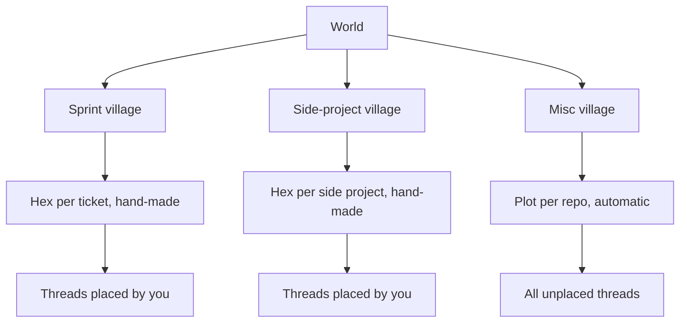
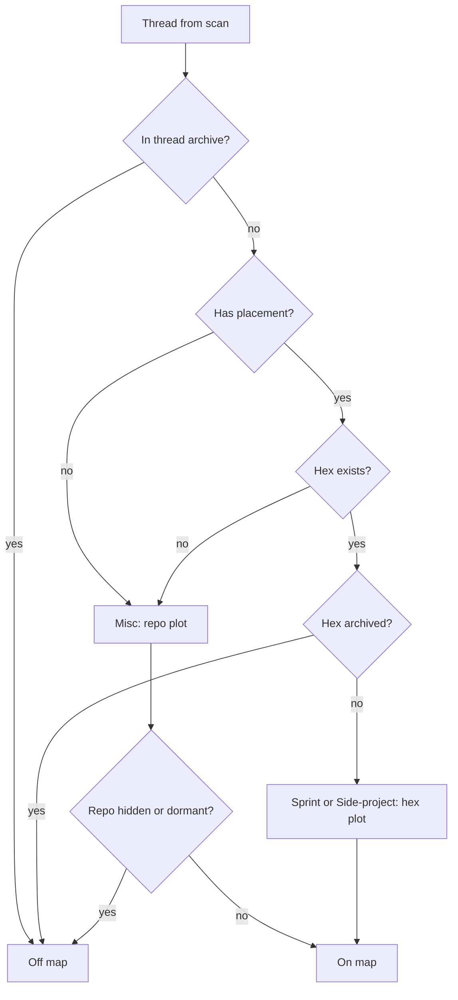

# Villages - Plan

## Goal Capsule

- **Objective:** Split the colony into three villages (Sprint, Side-project, Misc) inside one world, so threads about teammates' sprint tickets, company side projects, and everything else stop sharing one undifferentiated map.
- **Product authority:** the Product Contract below. It covers only the separation concept. Each village's own tracking (Jira, Confluence, side-project status) gets its own brainstorm and plan.
- **Authority order:** Product Contract, then Planning Contract, then unit bodies. When code contradicts a unit, follow the Product Contract and record the deviation.
- **Stop conditions:** stop and report if any of these happen: the same test fails twice after a fix attempt; the change needs a `STATE_VERSION` bump or a rewrite of saved `colony.json` data; a change reaches a harness adapter in `server/harnesses/` (harnesses are read-only); or a Misc plot moves on an existing saved layout.
- **Execution profile:** U1 and U2 are pure logic and should be test-first. U3 is pure too. U4 to U6 are page wiring, verified by a manual smoke run in the app.
- **Open blockers:** None.

---

## Product Contract

### Summary

One world holds three villages. The camera can fly between them or zoom out to show all three at once. Misc keeps today's map, with one plot per repo filled automatically. In Sprint and Side-project you create named hexes by hand, and you place threads into them when you start a new chat or by moving an existing thread. A finished hex is archived along with its threads and can be restored.

### Problem Frame

The user is a tech lead who is still on the on-call rotation. During a sprint he tracks two separate kinds of work: his teammates' tickets and the company side projects that count toward his yearly appraisal. Both currently land on one map grouped by repo. A repo-based map doesn't fit either kind of work. One sprint ticket can span several repos, and one repo can host both a teammate's ticket and one of his side projects. The goal is to spend most of the day in this app rather than across several pages. That requires the map to reflect how he thinks about the work (tickets and projects), not where the code lives.

### Key Decisions

- **One world, three regions.** The villages are regions of a single map, not separate screens or planets. This lets you see everything at once and keeps one planet look across all three. Switching between them like planets, a home-plus-insets layout, and a solar-system overview were all considered and rejected.
- **Placement is per thread, not per repo.** This handles a repo shared between Sprint and Side-project, at the cost of placing threads by hand. Misc stays repo-based and automatic.
- **Hexes are hand-made, and they can be empty.** A ticket you haven't touched with an agent still needs a hex. The Sprint village's later Jira session will fill these same hexes rather than replace them.
- **Archive, not delete.** Finished tickets and side projects stay retrievable, which is useful evidence at sprint review and appraisal time.
- **A thread lives in exactly one place.** That place is one hex, or its repo plot in Misc. A review thread that spans two tickets has to pick one of them.
- **No automatic routing.** Threads started outside the app land in Misc, even when the branch name carries a ticket key.

### Requirements

**World and villages**

- R1. The map shows three villages, Sprint, Side-project, and Misc, as distinct regions of one world.
- R2. You can fly the camera to any one village, or zoom out to see all three at once.
- R3. The world keeps one planet look. Villages don't get separate planets.

**Hexes**

- R4. In Sprint and Side-project you can create a hex with a name. Examples are a ticket like "LPG-1234 voucher fix" or a side project like "Agents of Empire".
- R5. A hex exists and shows on the map even when it holds no threads.
- R6. Misc has no hand-made hexes. Its plots stay one per repo, created and sized automatically as they are today.

**Placing threads**

- R7. Every thread lives in exactly one place: a hex in Sprint or Side-project, or its repo's plot in Misc.
- R8. You can move any thread by choosing a village and then a hex. Moving it to Misc returns it to its repo's plot.
- R9. New chat (`C` or **+**) keeps its existing repo choice and adds two optional fields, village and hex. With no hex chosen, the thread goes to Misc under its repo.
- R10. Threads started outside the app, from a terminal or another harness, appear in Misc under their repo until you move them.
- R11. A thread's placement survives app restarts and changes to the thread itself, such as a new branch or more messages.

**Archive**

- R12. You can archive a Sprint or Side-project hex. It leaves the map, and its threads go with it.
- R13. You can list archived hexes and restore one, which brings back the hex and its threads in the same village.
- R14. A new message on a thread inside an archived hex doesn't put the thread back on the map. It stays with its archived hex.

### Key Flows

- F1. **Start a sprint chat.** **Trigger:** you press `C`. **Steps:** pick a repo, then pick village Sprint and hex "LPG-1234". **Outcome:** the new thread's bot walks to the LPG-1234 hex in the Sprint village. **Covers R4, R9.**
- F2. **Sort a terminal thread.** **Trigger:** a Claude Code thread started in a terminal appears in Misc under its repo. **Steps:** select it, then choose the Side-project village and the "Agents of Empire" hex. **Outcome:** the bot leaves the Misc plot and walks to that hex. **Covers R8, R10.**
- F3. **Close out a ticket.** **Trigger:** LPG-1234 shipped. **Steps:** archive its hex. **Outcome:** the hex and its threads leave the Sprint village. Later, at appraisal time, you open the archived list and restore it. **Covers R12, R13.**

### Acceptance Examples

- AE1. **Given** new chat with repo `lapakgaming-api` and no hex chosen, **when** the thread starts, **then** it appears in Misc on the `lapakgaming-api` plot. **Covers R9.**
- AE2. **Given** an empty hex "LPG-2000" in Sprint, **when** the app restarts, **then** the hex is still on the map with no threads. **Covers R5, R11.**
- AE3. **Given** a thread in hex "LPG-1234" whose branch later changes to `feature/LPG-1300`, **when** the map refreshes, **then** the thread stays in "LPG-1234". **Covers R11.**
- AE4. **Given** an archived hex holding a thread, **when** that thread gets a new message, **then** the thread stays archived and doesn't appear in Misc. **Covers R14.**
- AE5. **Given** two threads in the same repo, one placed in Sprint and one left unplaced, **when** you view the world, **then** the first is in its Sprint hex and the second is on that repo's plot in Misc. **Covers R7.**

### Scope Boundaries

**Deferred to each village's own session**

- Sprint: importing tickets from Jira, ticket status, what happens after merge (tests, deploy prep), blockers, and comparing the async stand-up Confluence page against each ticket's state.
- Side-project: what each project needs and its current status.

**Not in this version**

- Automatic routing of threads into hexes by branch name, ticket key, or path.
- A thread in more than one hex.
- More than three villages, or renaming the villages.
- A separate planet look for each village.

### Dependencies / Assumptions

- Assumption: Misc keeps its current repo behaviours (hiding a repo, dormant folding, same-name disambiguation) unchanged, and they apply only to threads still in Misc.
- Assumption: the three villages are three wedges of the same island around the ship, not three separate islands. Confirmed at plan time.
- Assumption: the existing hub plot for harness home folders (`.claude` and similar) stays in Misc.

### Outstanding Questions

**Resolved during planning**

- Hiding a repo affects Misc only. A thread placed in a Sprint or Side-project hex stays visible even when its repo is hidden.
- Each hex takes a colour from the existing plot palette, the same way a repo does.
- A restored hex takes back its old spot when that ground is still free. It moves somewhere new only when another plot has taken it since.

### Sources / Research

- `src/game/colony.js:514-552` groups threads by `thread.project` (repo folder name) into zones, biggest first. This grouping is what Misc keeps and what Sprint and Side-project replace.
- `src/world/plots.js:11-22` allocates plots by thread count. Today a plot with zero threads can't exist (see R5).
- `src/game/hidden-projects.js:9-13` keys hiding on the repo folder name, which breaks silently on a same-name rename. Placement should not inherit that weakness (R11).
- `DECISIONS.md:72-74` notes the layout is keyed on prefixed thread ids, so a stable id exists to attach placement to.
- `server/api.mjs:72-88` and `DECISIONS.md:11` describe `data/colony.json` as the only file the app writes. It already holds `hiddenProjects`, `plots`, `titles`, and `settings`.
- `docs/FEATURES.md:118` documents the New chat flow that R9 extends.
- `src/world/planet.js:30-31`: a planet is a visual theme only, which R3 relies on.

---

## Planning Contract

Product Contract preservation: Product Contract unchanged. The three planning questions are resolved in place under Outstanding Questions.

### Key Technical Decisions

- KTD1. **Villages are wedges of one board, not separate boards.** The colony is one hex lattice that grows out from the ship, and the Medieval town wall, the island planets and the hub cell all assume that one centre (`src/world/plots.js` `layOut`, `src/world/hexboard.js` `growTown`). Each village owns a 120-degree sector around the origin. A new plot seeds and grows inside its own sector. Misc owns the sector holding the hub cell, so `.claude` keeps the middle.
- KTD2. **Misc plot ids stay bare repo names.** Saved layouts in `colony.json` `plots` are keyed by repo name. Keeping those keys means no migration and no `STATE_VERSION` bump, and every existing Misc plot stays where it is. Hex plots use a prefixed id (`hex:<id>`) that can't collide with a repo name.
- KTD3. **Placement is keyed on thread id.** Thread ids are already the stable key for layout and the archive list (`DECISIONS.md`, "Thread ids are prefixed"). Keying placement on the thread id, not on repo, branch or path, is what lets a placement survive branch changes and same-name renames (R11).
- KTD4. **Two new keys in the colony file, both written by the page.** `hexes` maps a hex id to its village, name, archived flag and creation time. `placements` maps a thread id to a hex id. Both go through the same single-writer save and three-way merge as `plots` (`src/game/merge-state.js` `mergeMap`). The server only whitelists them (`server/api.mjs` `readState`/`writeState`).
- KTD5. **One pure function decides where every thread goes.** It takes the scan, hexes, placements, hidden repos and archived thread ids, and returns plots with their village, label and threads, including empty hexes. Today this logic is spread between `liveThreadsForColony` and the grouping at the top of `Colony.setThreads`. Pulling it out keeps it testable under bare node, like `merge-state.js`.
- KTD6. **Archiving a hex is not archiving a thread.** The existing thread archive (`state.archived`) walks a bot back to the ship. An archived hex just drops off the map along with its threads, and their placements stay intact. A hex in a placement that no longer exists falls back to Misc, so stale data never loses a thread.
- KTD7. **New chat records placement on the `session` event.** A new thread learns its id from the first `session` event the page receives (`server/chat.mjs`, the `newChatThread` call). The page writes the placement then, before the next scan, so the bot never appears in Misc first.

### High-Level Technical Design

Where a thread lands:

Board split: three sectors around the origin. Misc holds the hub cell and the ship. Sprint and Side-project hold the other two sectors. Plots already saved stay where they are. Only new plots use the sector rule.

### Sequencing

U1, U2 and U3 have no dependencies. U4 needs U1 to U3. U5 needs U4. U6 needs U5.

---

## Implementation Units

### U1. Hexes and placements in the colony file

- **Goal:** Persist `hexes` and `placements` through load, save, and the two-tab merge.
- **Requirements:** R5, R11, R12, R13.
- **Dependencies:** none.
- **Files:** `server/api.mjs`, `src/game/merge-state.js`, `src/main.js` (initial `state`), `test/state.test.mjs`.
- **Approach:** Add both keys to `emptyState`, `readState` and `writeState`, sanitised like `plots` and `titles`. Drop entries whose shape is wrong, and drop a hex whose village isn't `sprint` or `side`. Merge both keys with `mergeMap`.
- **Patterns to follow:** `titles` (`asTitles`) for sanitising, and the `plots` merge tests in `test/state.test.mjs`.
- **Test scenarios:**
  - A hex added in one tab and a placement added in another tab both survive the merge.
  - Archiving a hex in one tab while another tab renames a different hex keeps both changes.
  - Removing a placement in this tab survives the merge and isn't resurrected by the other tab's copy.
  - A file without `hexes` or `placements` loads with both empty, and the version stays 2.
  - A hex with an unknown village, or a placement whose value isn't a string, is dropped on read.
- **Verification:** `npm test` passes, and an old `colony.json` loads unchanged.

### U2. Where each thread goes

- **Goal:** One pure function returns the plots to draw: Misc repo plots and hex plots, with each plot's village, label and threads.
- **Requirements:** R5, R6, R7, R10, R12, R14. **Covers F2, AE1, AE4, AE5.**
- **Dependencies:** none.
- **Files:** `src/game/villages.js` (new), `src/game/hidden-projects.js` (filtering moves or delegates here), `test/villages.test.mjs` (new).
- **Approach:** Implement the flowchart above. Hidden repos filter Misc only. Unplaced threads group by `thread.project` exactly as today. Every non-archived hex yields a plot, even with zero threads. Dormant folding stays in `Colony.setThreads` and applies to Misc plots only.
- **Patterns to follow:** `liveThreadsForColony` and `hiddenCatalog` in `src/game/hidden-projects.js`, which are pure and node-testable.
- **Test scenarios:**
  - Covers AE1. An unplaced thread in repo `lapakgaming-api` lands on the Misc plot `lapakgaming-api`.
  - Covers AE5. Two threads in the same repo, one placed in a Sprint hex and one not, land in the Sprint hex and in Misc.
  - Covers AE4. A thread placed in an archived hex is off the map and doesn't appear in Misc.
  - An empty, non-archived hex yields a plot with zero threads.
  - A placement pointing to a deleted hex sends the thread back to Misc.
  - A hidden repo hides its Misc plot but not its threads placed in hexes.
  - A thread in the thread archive is off the map even when it's placed in a hex.
- **Verification:** the new tests pass, and the existing hidden-repo behaviour is unchanged for unplaced threads.

### U3. Wedge allocation on the board

- **Goal:** New plots seed and grow inside their village's sector without moving any plot that's already placed.
- **Requirements:** R1, R6. Supports R13 (restore takes back its old spot).
- **Dependencies:** none.
- **Files:** `src/world/plots.js` (`allocateCells`, `layOut`, `growBlob`), `test/villages-layout.test.mjs` (new). Keep `test/hub.test.mjs` and `test/plot-move.test.mjs` passing.
- **Approach:** Each project in `allocateCells` may carry a `village`, and a missing village means Misc. Add a sector function based on a cell's angle around the origin. When a plot is new, filter the seed pool to its sector. Growth prefers free cells in its own sector and crosses into another sector only when its own is full. Plots that are already placed keep their cells. The `isConnected` fallback stays global.
- **Execution note:** Pin current behaviour first. With every project in Misc, the output must match today's for the existing hub and plot-move tests.
- **Test scenarios:**
  - With every project unlabelled, the layout is identical to today's for the same inputs.
  - A new Sprint plot seeds in the Sprint sector, and a new Side-project plot seeds in the Side-project sector.
  - The `.claude` hub still takes the origin cell.
  - A Misc plot already saved inside what is now the Sprint sector keeps its cells.
  - A previous layout for a hex id (a restored hex) keeps its cells when they're free.
  - A sector filled to the pool limit lets a new plot spill over rather than fail with no cells.
- **Verification:** the new and existing layout tests pass.

### U4. Colony draws villages

- **Goal:** `Colony.setThreads` draws plots from U2, passes villages to U3, labels hex plots with their hex name, and shows a ground label for each village.
- **Requirements:** R1, R2, R3, R5.
- **Dependencies:** U1, U2, U3.
- **Files:** `src/game/colony.js`, `src/main.js` (call site and a `focusVillage` action next to `focusProject`), `src/ui/hud.js` (three village buttons in the View group).
- **Approach:** Replace the inline repo grouping with the U2 result. Plot ids follow KTD2. Archived hex plots keep their layout memory, the way hidden and dormant repos do. Flying to a village focuses the centroid of its sector at a wider distance than `focusProject`. Zooming out to see all three is the existing zoom.
- **Patterns to follow:** `focusProject` in `src/main.js`, and the layout-memory reinsertion for hidden and dormant plots in `Colony.setThreads`.
- **Test expectation:** none here. This is 3D wiring; U2 and U3 carry the logic tests. Verify with the manual smoke run.
- **Verification:** with no hexes defined, the colony looks exactly as it does today. With hexes defined, Sprint and Side-project plots appear in their wedges and carry their names.

### U5. Managing hexes and moving threads

- **Goal:** Create, archive and restore hexes, and move a thread to a village and hex.
- **Requirements:** R4, R8, R12, R13. **Covers F2, F3.**
- **Dependencies:** U4.
- **Files:** `src/ui/hud.js`, `src/main.js`, `src/ui/styles.css`.
- **Approach:** Add a Villages section to the HUD, in the panel style already used for hidden repos. It lists each village's hexes with archive and restore, and has a name field to create a hex. The selected-thread inspector gets a "Move to" control next to Archive: pick a village, then a hex, where Misc means remove the placement. Every change updates `state` and saves through the existing `saveState` path.
- **Patterns to follow:** the hide and unhide actions (`hideProject`/`unhideProject` in `src/main.js`) and the hidden-repo list in `src/ui/hud.js`.
- **Test expectation:** none beyond U1 and U2. These are UI handlers over state those units already test.
- **Verification:** in the running app, creating a hex shows an empty plot in its wedge. Moving a thread walks its bot to the hex. Archiving the hex takes the hex and its threads off the map, and restoring brings them back to the same spot.

### U6. Village and hex in New chat

- **Goal:** New chat (`C` or **+**) gains optional village and hex fields next to the repo picker.
- **Requirements:** R9. **Covers F1, AE1.**
- **Dependencies:** U5.
- **Files:** `src/ui/chat.js` (`openNew` and the `session` event handler), `src/main.js`.
- **Approach:** Two selects follow the existing `.repo-pick` select: village (default Misc), then the non-archived hexes in that village. They lock once the thread starts, as the repo picker does. When the `session` event arrives with the new thread's id, write the chosen placement and save (KTD7). With no hex chosen, write nothing.
- **Patterns to follow:** `.repo-pick` in `openNew` and `pickRepo`.
- **Test expectation:** none beyond U2. Verify with the smoke run.
- **Verification:** a chat started with a Sprint hex chosen lands its bot in that hex, never in Misc first. A chat started with no hex lands in Misc on its repo's plot.

---

## Verification Contract

| Gate | Command or check | Applies to |
|---|---|---|
| Unit tests | `npm test` | U1, U2, U3, and every unit for regressions |
| Build | `npm run build` | U4 to U6 |
| Smoke run | `npm run dev`, then walk F1, F2 and F3 and AE2 (restart with an empty hex) in the browser | U4 to U6 |
| Layout stability | open the app on an existing `colony.json` with no hexes; no Misc plot moves | U3, U4 |

---

## Definition of Done

- Every unit's verification holds, and `npm test` and `npm run build` pass.
- An existing `colony.json` loads without migration, and its Misc layout is unchanged.
- F1, F2, F3 and AE1 to AE5 pass in the smoke run.
- `docs/FEATURES.md` gets a short Villages entry.
- No experimental or abandoned code is left in the diff. The unrelated uncommitted edits already in the working tree (`server/mdfile.mjs`, `src/ui/chat.js`, `src/ui/styles.css`, `test/mdfile.test.mjs`) are not mixed into this work.
